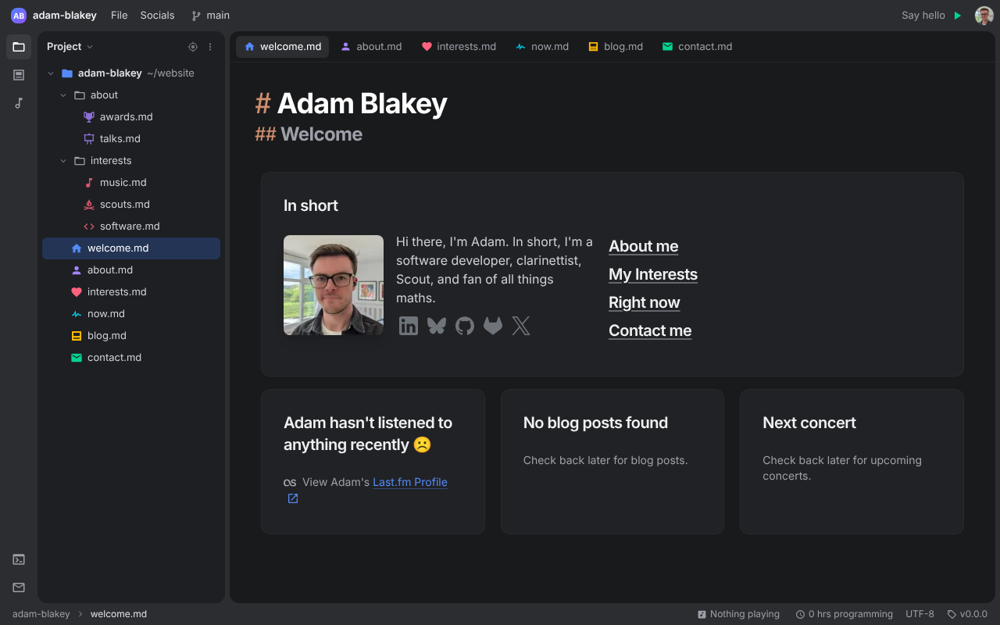
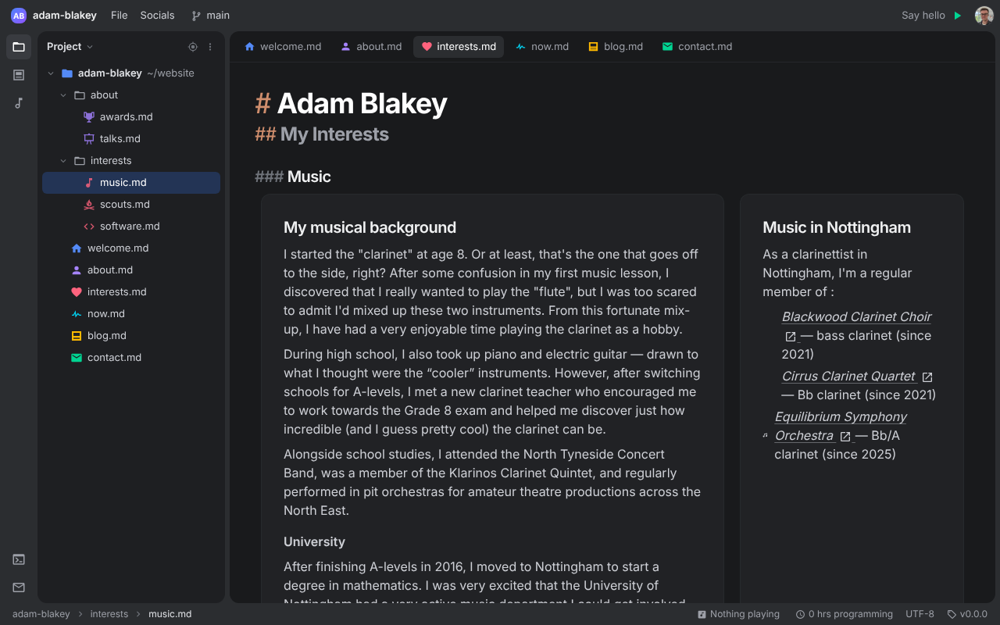
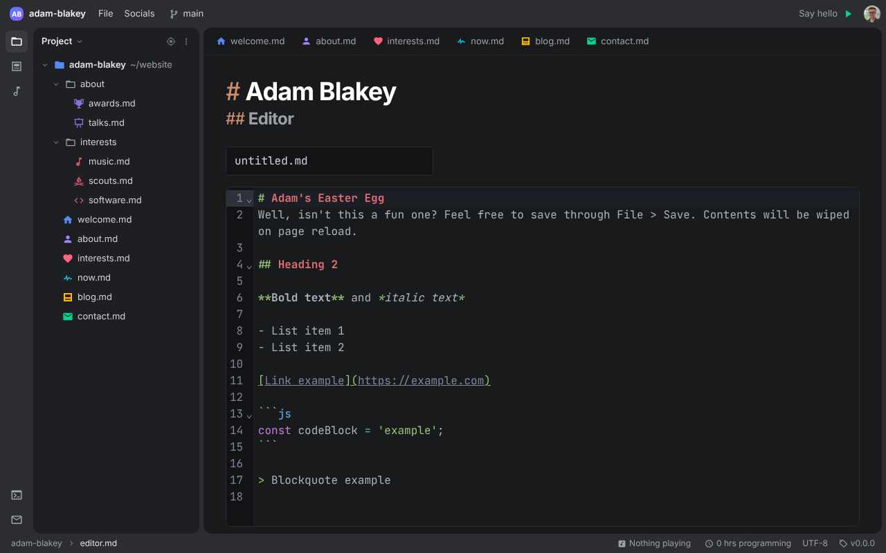
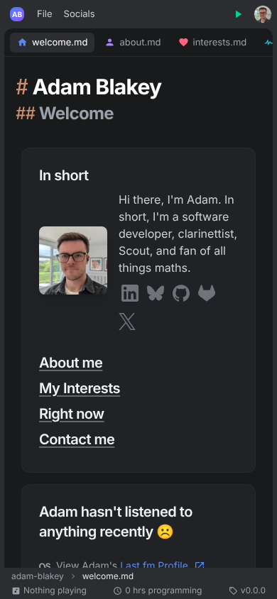

# Adam Blakey's website

[](https://github.com/adam-blakey/website/actions/workflows/deploy.yml)
[](https://github.com/adam-blakey/website/actions/workflows/conventional-commits.yml)
[](https://github.com/adam-blakey/website/releases)


My personal website, styled like a code editor: pages are "files" in a project tree and open as tabs.



| Interests | Editor | Mobile |
| --- | --- | --- |
|  |  |  |

## Features

- **Blog** imported from WordPress, with categories, tags, responsive images and embedded video.
- **Now playing** from Spotify, falling back to Last.fm or ListenBrainz when Spotify isn't playing, and **programming time** from Wakapi.
- **Upcoming concerts**, awards and talks.
- **Contact form** with reCAPTCHA v3, rate limiting and confirmation emails.
- **Markdown editor** (CodeMirror) at `/editor`.
- Sitemap at `/sitemap.xml`.

## Running locally

Needs PHP 8.5, Composer and Node.

```bash
composer install
npm ci
cp .env.example .env
php artisan key:generate
touch database/database.sqlite
php artisan migrate
php artisan images:resize
npm run build
php artisan serve
```

Set `LARAVEL_CLOUDFLARE_ENABLED=false` in `.env` if the machine can't reach Cloudflare's IP list. API keys for Spotify, Last.fm, ListenBrainz, Wakapi and the WordPress import go in `.env`; see `.env.example`.

Logs go to `storage/logs` and, with `LOG_STACK=single,nightwatch`, to Nightwatch. Errors and warnings that commands print are logged too, since the scheduler discards command output.

### Scheduled commands

`routes/console.php` runs these via `php artisan schedule:run`:

| Command | Runs |
| --- | --- |
| `music:fetch`, `programming-time:fetch`, `app:send-contact-confirmation-emails` | every minute |
| `blog:import-wordpress`, `blog:generate-responsive-images`, `concerts:import`, `music:clear-old` | hourly |
| `cloudflare:reload` | daily |

### Spotify now playing

`music:fetch` asks Spotify first. When Spotify has nothing playing (stopped, paused, a podcast, or an API error) it falls back to Last.fm and ListenBrainz. To set it up:

1. In the [Spotify developer dashboard](https://developer.spotify.com/dashboard), create an app with the **Web API** and the redirect URI `http://127.0.0.1:8888/callback`. Copy its client ID and client secret.
2. Sign in to Spotify as yourself and open this URL, with your client ID filled in, and approve:
   `https://accounts.spotify.com/authorize?response_type=code&scope=user-read-currently-playing&redirect_uri=http://127.0.0.1:8888/callback&client_id=CLIENT_ID`
3. The browser lands on `http://127.0.0.1:8888/callback?code=...` and fails to load. That's fine: copy the `code` from the address bar and swap it for a refresh token within a few minutes:

   ```bash
   curl -X POST https://accounts.spotify.com/api/token -u CLIENT_ID:CLIENT_SECRET -d grant_type=authorization_code -d redirect_uri=http://127.0.0.1:8888/callback -d code=CODE
   ```

4. Put the `refresh_token` from the response in `.env`, with your Spotify username (shown on [your account page](https://www.spotify.com/account/profile/)) for the profile link:

   ```
   SPOTIFY_ENABLED=true
   SPOTIFY_CLIENT_ID=...
   SPOTIFY_CLIENT_SECRET=...
   SPOTIFY_REFRESH_TOKEN=...
   SPOTIFY_USER_ID=...
   ```

The refresh token doesn't expire unless you remove the app's access from your Spotify account or reset the client secret. If either happens, repeat steps 2 to 4 and put the new token in `.env`. If Spotify sends back a replacement refresh token, the site saves it in its cache and uses it from then on.

## Tests

```bash
php artisan test
```

## Deployment

[`deploy.yml`](.github/workflows/deploy.yml) builds and tests every push and pull request, then deploys over SSH:

- Pull requests deploy to staging.
- Merges to `main` deploy to staging, then to production after the environment's wait timer, and publish a GitHub release.

Commits follow [Conventional Commits](https://www.conventionalcommits.org); the release version bump is worked out from them. See the [PR template](.github/pull_request_template.md).
