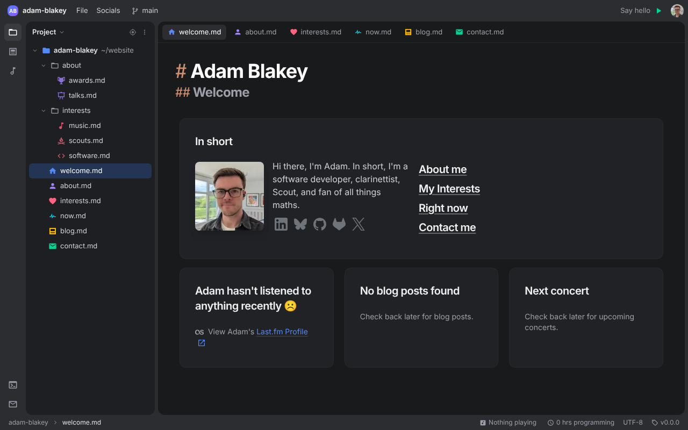
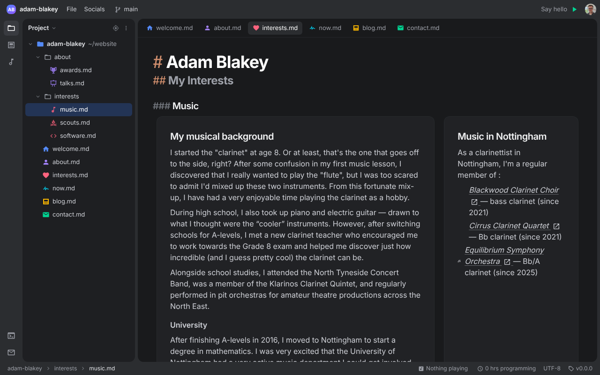
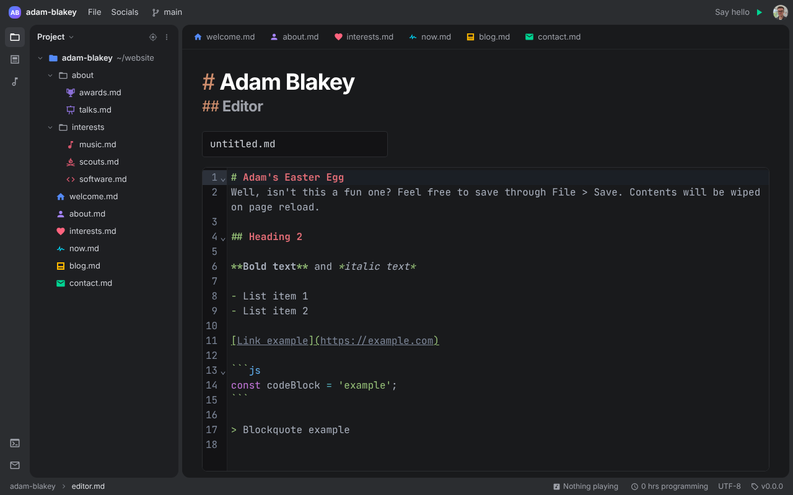
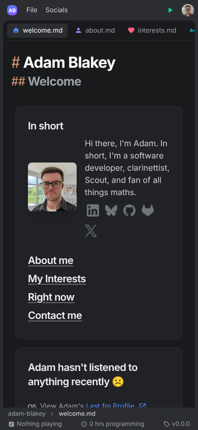

# Adam Blakey's website

[](https://github.com/adam-blakey/website/actions/workflows/deploy.yml)
[](https://github.com/adam-blakey/website/actions/workflows/conventional-commits.yml)
[](https://github.com/adam-blakey/website/releases)


My personal website, styled like a code editor: pages are "files" in a project tree and open as tabs.



| Interests | Editor | Mobile |
| --- | --- | --- |
|  |  |  |

## Features

- **Blog** imported from WordPress, with categories, tags, responsive images and embedded video.
- **Now playing** from Last.fm or ListenBrainz, and **programming time** from Wakapi.
- **Upcoming concerts**, awards and talks.
- **Contact form** with reCAPTCHA v3, rate limiting and confirmation emails.
- **Markdown editor** (CodeMirror) at `/editor`.
- Sitemap at `/sitemap.xml`.

## Running locally

Needs PHP 8.5, Composer and Node.

```bash
composer install
npm ci
cp .env.example .env
php artisan key:generate
touch database/database.sqlite
php artisan migrate
php artisan images:resize
npm run build
php artisan serve
```

Set `LARAVEL_CLOUDFLARE_ENABLED=false` in `.env` if the machine can't reach Cloudflare's IP list. API keys for Last.fm, ListenBrainz, Wakapi and the WordPress import go in `.env`; see `.env.example`.

### Scheduled commands

`routes/console.php` runs these via `php artisan schedule:run`:

| Command | Runs |
| --- | --- |
| `music:fetch`, `programming-time:fetch`, `app:send-contact-confirmation-emails` | every minute |
| `blog:import-wordpress`, `blog:generate-responsive-images`, `concerts:import`, `music:clear-old` | hourly |
| `cloudflare:reload` | daily |

## Tests

```bash
php artisan test
```

## Deployment

[`deploy.yml`](.github/workflows/deploy.yml) builds and tests every push and pull request, then deploys over SSH:

- Pull requests deploy to staging.
- Merges to `main` deploy to staging, then to production after the environment's wait timer, and publish a GitHub release.

Commits follow [Conventional Commits](https://www.conventionalcommits.org); the release version bump is worked out from them. See the [PR template](.github/pull_request_template.md).
